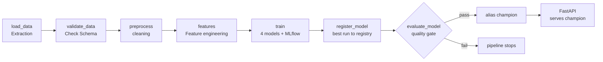

# mlops-course - diabetes progression end-to-end

Final project of the MLops module: a basic end-to-end MLOps system for a regression problem.
Starting from an exploratory notebook, the project has been migrated to a repository with reusable scripts for every stage:

- Data extraction
- Data validation
- Data cleanup
- Feature engineering
- Model training with MLflow tracking
- Model registration
- Champion selection through a quality gate
- Model serving with FastAPI
- CI/CD with GitHub actions

The goal is not a full production system but a clear demonstration of th ekey MLOps concept and usage of clean separation of responsabilities

## Dataset

Diabetes dataset from scikit-learn

https://www.geeksforgeeks.org/machine-learning/sklearn-diabetes-dataset/

- 442 patients, 10 numerical features: `age`, `sex`, `bmi` , `bp`, and six blood serum measurements `s1`...`s6`
- `target`: a quantitative measure of disease progression one year after baseline, from 25 to 346
- The 10 features are already mean centered and scaled by the standard deviation times the square root of `n_samples`. The sum of squares of each column totals 1
- In this regard, the proposed solution checks that all input feature values lay within the -1, +1 range, to reject unscaled input

## Pipeline



## Repository structure
```
<root>
│   Dockerfile                             # API image (includes MLflow registry)<br>
│   requirements.txt                       # Fixed dependencies<br>
│   run_api.sh                             # Builds and runs the API container<br>
│   run_pipeline.sh                        # Runs the whole pipeline locally (same order as CI)<br>
│   run_test_api.sh                        # API Smoke tests (used locally and in CI)<br>
├───notebooks<br>
│      └  Proyecto_MLOps.ipynb             # Exploratory analysis and first modeling (provided)<br>
└───src<br>
    │   ├ config.py                        # Paths, constants, hyperparams, quality thresholds<br>
    │   └ schemas.py                       # Pydantic schemas shared for validation and API<br>
    ├───api<br>
    │   ├ main.py                          # FastAPI app and endpoints<br>
    │   ├ model.py                         # Loads the champion model at startup, model state<br>
    ├───data<br>
    │   ├ load_data.py                     # Extraction -> data/raw/diabetes.csv<br>
    │   ├ preprocess.py                    # Cleaning -> data/processed/train_v1.csv<br>
    │   ├ features.py                      # Feature eng. -> data/processed/train_features_v1.csv<br>
    │   └ validate_data.py                 # Schema validation for all rows. exits 1 on failure<br>
    ├───models<br>
         ├ evaluate_model.py               # Evaluates the last version, applies quality gate<br>
         ├ register_model.py               # Registers best run in the Model Registry<br>
         └ train.py                        # Trains 4 models, logs params/metrics/artifacts<br>
```

Generated folders are not versioned `data/raw/`, `data/processed/` and `mlruns/` are created by the pipeline

## Installation

Requirements: Python 3.12, DOcker and bash (Linux, macOS, WSL or Git Bash on Windows)

```bash
git clone https://github.com/oscargonzalezmunyoz/mlops-course.git
cd mlops-course
python 3.12 -m venv .venv
source .venv/bin/activate # Windows: .venv\Scripts\activate
pip install -r requirements.txt
```

All dependencies are set to exact versions. The same Python version and libraries are used locally, in the Docker image, and in CI. So a model trained in one place loads with version mismatches in the other environments.

## Running the pipeline

Run the whole pipeline locally with one command

```bash
./run_pipeline.sh            # run all steps
./run pipeline.sh --clean    # delete generated data and mlruns, then run
```

The script stops at the first failing step. Each step can also be run on its own, from the project root:

| Step                    | Command                             | What it does                                                                                                                                                                                                               |
| ----------------------- | ----------------------------------- | -------------------------------------------------------------------------------------------------------------------------------------------------------------------------------------------------------------------------- |
| Extraction              | `python -m src.data.load_data`      | Loads the dataset from scikit-learn and saves it to `data/raw/diabetes.csv`                                                                                                                                                |
| Validation              | `python -m src.data.validate_data`  | Validates every row against the `DiabetesRecord` Pydantic schema. <br>- All required columns and the target must exist<br>- Values are numerical<br>- Features are within [-1, +1]<br>- Exits with code 1 if any row fails |
| Cleaning                | `python -m src.models.preprocess`   | - Coerces all columns to numeric<br>- Drops rows with missing values<br>- Removes duplicates<br>- Saves `data/processed/train_v1.csv`                                                                                      |
| Feature<br/>Engineering | `python -m src.data.features`       | Adds the three engineered features described below. Saves `data/processed/train_features_v1.csv`                                                                                                                           |
| Training                | `python -m src.models.train`        | Trains the models and logs everything to MLflow                                                                                                                                                                            |
| Registration            | python -m src.models.register_model | Registers the best run in the MLflow Model Registry                                                                                                                                                                        |
| Evaluation              | python -m src.models.evaluate_model | Evaluates the latest registered version and assigns the `champion` alias if it passes the quality gate                                                                                                                     |

## Feature engineering

`src/data/features.py`adds three features explored in the notebook

| Feature               | Formula     | Description                                                                                  |
| --------------------- | ----------- | -------------------------------------------------------------------------------------------- |
| `bmi_age_interaction` | `bmi * age` | Combined effect of body mass index and age                                                   |
| `bp_bmi_interaction`  | `bp * bmi`  | COmbined effect of blood pressure and body mass index                                        |
| `s1_s2_ratio`         | `s1 / s2`   | Ratio between the first 2 measurements<br/>Division by zero is avoided with a small constant |

The models are therefore trained on 13 features instead of the 10 original

The same `feature_engineering()`function is used in the pipeline stage and in the API on every `/predict`request, to transform the incoming data before calling the model.

Clients only send the 10 original features, and the API computes the rest. This way, both training and serving always use the same transformations.

## Model training and MLflow tracking

``train.py`` splits the processed data into train and test sets (80/20) with `random_state=42`and trains four models, each one in its own MLflow run inside the `diabetes`experiment:

| model                              | Purpose                                                                    |
| ---------------------------------- | -------------------------------------------------------------------------- |
| `DummyRegressor` <sub>(mean)</sub> | Baseline: always predicts the training meam. Any useful model must beat it |
| `LinearRegression`                 | Simple, interpretable model                                                |
| `RandomForestRegressor`            | 100 trees, `max_depth=15`                                                  |
| `GradientBoostingRegressor`        | Default hyperparameters                                                    |

For every run, MLflow stores:

- Parameters: the model hyperparameters

- Metrics: RMSE, MAE and R^2 on the test set.

- Tags: `model_type`, `dataset`and `stage=training`


### Approximate rest results with the current split:

| model                     | rmse  | mae   | r2    |
| ------------------------- | ----- | ----- | ----- |
| DummyRegressor            | 73.22 | 64.0  | -0.01 |
| LinearRegression          | 53.85 | 42.79 | 0.45  |
| ForestForestRegressor     | 53.99 | 43.76 | 0.45  |
| GradientBoostingRegressor | 53.73 | 44.52 | 0.45  |

**With feature engineering**

| model                     | rmse  | mae   | r2    |
| ------------------------- | ----- | ----- | ----- |
| DummyRegressor            | 73.22 | 64.0  | -0.01 |
| LinearRegression          | 52.46 | 41.67 | 0.48  |
| ForestForestRegressor     | 55.39 | 44.32 | 0.42  |
| GradientBoostingRegressor | 56.12 | 45.65 | 0.40  |

When we don't perform feature engineering, the winner is GradientBoostingRegressor, but after adding the new features, LinearRegression is the new champion, same as in the notebook.

To browse the runs:

```bash
mlflow ui --backend-store-uri ./mlruns
```

Then open http://localhost:5000

### Champion model selection

1. Registration (`register_model.py`): searches the finished runs on the `diabetes` experiment, picks the one with the lowest RMSE and register it as a new version of `diabetes-model`, with a description that contains its metrics

2. Evaluation and quality gate (`evaluate_model.py`): loads the latest registered version, evaluates it with `mlflow.evaluate()` (logged sepparately with `stage=evaluation`) and applies the quality gate.

| Metric | Threshold |
| ------ | --------- |
| RMSE   | < 60      |
| R^2    | > 0.40    |

> This metric was chosen based on the results of DummyRegressor and comparing it to the rest of the models, choosing reasonable values around 54 RMSE and 0.45 r2, leaving a small margin below the expected performance, so that normal variation does not break the pipeline, but a wrong model or data does.


If both conditions hold, the version receives the `champion`alias. If not, the alias is not assigned (the previous champion, if exists, stays), and the script exits with code 1, stopping the pipeline and failing CI

## API

The API (FastAPI) loadas the champion model once at startup, and keeps it in memory

#### Running the API

###### With docker (recommended)

```bash
./run_api.sh
```

This builds the `mlops-api`image and runs it on port 8000. The image includes the local `mlruns/` folder, so run the pipeline first.

To serve a newly promoted champion, run `run_api.sh` again. The image is rebuilt with the updated registry

###### Without Docker, from the project root:

```bash
uvicorn src.api.main:app --port 8000
```

Interactive documentation is available at http://localhost:8000/docs

**Endpoints**

| Method | Endpoint      | Description                                                           |
| ------ | ------------- | --------------------------------------------------------------------- |
| GET    | `/health`     | Liveness check. Returns 200 while the service is running              |
| GET    | `/model_info` | Name, version, alias and source run of the model being served         |
| POST   | /predict      | Validates the input and returns the prediciton and the model version. |

**Testing the endpoints**

Run all the smoke tests with the API running:

```bash
./run_test_api.sh
```

THe script checks the three endpoints and two invalid inputs, exiting with code 1 with any check fails.

It uses `http://localhost:8000`by default. Set `API_URL` to test another adress.

**Manual examples**

*Request*

```bash
curl http://localhost:8000/health
```

*Response*

```json
{"status": "ok", "model": "diabetes-model"}
```

*Request*

```bash
curl http://localhost:8000/model-info
```

*Response*

```json
{"model_name": "diabetes-model", "version": "1", "alias": "champion", "run_id": "18164071f8754ab4bd816fb298cded47"}
```

*Request*

```bash
curl -X POST http://localhost:8000/predict \
  -H "Content-Type: application/json" \
  -d '{"age":0.038,"sex":0.05,"bmi":0.0617,"bp":0.0219,"s1":-0.0442,"s2":-0.0348,"s3":-0.0434,"s4":-0.0026,"s5":0.0199,"s6":-0.0176}'
```

*Response*

```json
{"prediction": 237.36, "model_version": "1"}
```

#### Error Handling

| Case               | Response                      | How it is handled                                                                                                                                                           |
| ------------------ | ----------------------------- | --------------------------------------------------------------------------------------------------------------------------------------------------------------------------- |
| Valid request      | 200 `OK`                      | Prediction and model version returned                                                                                                                                       |
| Missing feature    | 422 `Unprocessable entity`    | The `DiabetesFeatures`Pydantic schema rejects the request before it reaches the model<br/>The response lists the invalid fields.                                            |
| Model not loaded   | 503<br/>`Service unavailable` | If the champion cannot be loaded at startup from the registry, the API still starts and logs the error.<br/>`/health`answers 200<br/>`/model-info`and `/predict` answer 503 |
| Prediction failure | 500 `Internal Server Error`   | Any other exception raised by the model during pprediction is logged and returned as a generic error                                                                        |

The 422 cases are covered by `run_test_api.sh`

To see the 503 case, start the API with `uvicorn` before running the pipeline and call `/model-info`

## CI/CD

The workflow in `.github/workflows/ci.yml`runs on every push to `main` or `master`, and can also be launched manually from the Actions tab (`workflow_dispatch`). 

On a clean ubuntu runner, it:

1. Checks out the code and installas Python 3.12 and the dependencies

2. Runs the full pipeline in order: extraction -> validation -> cleaning -> training -> registration -> evaluation. validation and the quality gate exit early with code 1 on failure, so a data problem or underperforming models stop the workflow

3. Builds the API docker image, which includes the registry generated in step 2

4. Starts the container and waits for 30 seconds for `/health` to answer

5. Runs `run_test_api.shp , the same smoke tests used locally

6. If any step fails, prints the container status and logs.


## Design considerations and limitations

**Registry inside the image**

For simplicity, the MLflow registry `mlruns/`is copied into the Docker image. A production setup would use a remote tracking server and an artifact store

**Model path in Docker**

MLflow stores absoulte artifact paths from the machine where the model was trained, which do not exist in the container. The API rebuilds the model path from the registry metadata instead

**Champion updates need a restart**

The model is loaded once at startup, so a new champion is served after restarting (or rebuilding) the API.

**Test set is also used for model selection**

The best run is chosen by its test RMSE, so the final metrics are slightly optimistic. A train/validation/test split would keep the test set for the final evaluation only.

**Changes from the notebook**

The pipeline adds a `DummyRegressor`baseline to choose the threshold values for model validation.


    
